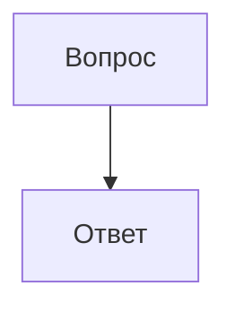
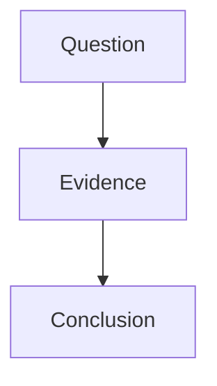
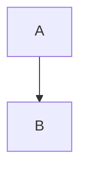

# Общая фикстура Claude / OpenAI

**Жирный**, *курсив*, ~~удалённый~~, `snake_case`, [источник](https://example.org/a_b).

> Цитата

- [x] Готово
- [ ] Ещё работа
  - Вложенный список

---

````python
example = "```"
print("😀 философия")
````

```
plain text
```

| Название | Значение |
| :-- | --: |
| `a|b` | 2<br>3 |
| x\|y | 4 |

Формулы: $x^2$, \(a+b\). Деньги: $5 и $10, а также \$20.

$$
\int_0^1 x^2 dx = \frac{1}{3}
$$

\[
E = mc^2
\]



```mermaid
this is broken
```

```html
<h1>Локальное превью</h1><script>alert("blocked")</script>
```

```svg
<svg xmlns="http://www.w3.org/2000/svg" width="100" height="50"><circle cx="25" cy="25" r="20" fill="blue"/></svg>
```

<script>alert(1)</script>
[опасная ссылка](javascript:alert(1))
<details><summary>Подробнее</summary>Данные</details><sup>2</sup><sub>0</sub>

<file name="science.txt">
😀 Научный текст
inline </file> stays literal
</file>

<file name="unfinished.md">
Этот файл ещё пишется…
# Offline scientific preview fixtures

Цена $5 и $10. Формула $x^2+y^2=z^2$, а также \(\frac{a}{b}\).

$$
\int_0^1 x^2\,dx = \frac{1}{3}
$$

\[
E=mc^2
\]

`$not_math$` и \$20 остаются текстом.





```latex
\invalidCommand{must_fall_back_to_source}
```

<details>
<summary>Доказательство</summary>
x<sup>2</sup> и H<sub>2</sub>O.
</details>
